# AquaWatt — Territory Predictive Insights


**Painel mobile em Flutter que antecipa desperdício de água e energia e eventos climáticos em 5 bairros de São Paulo, com alertas explicáveis (evidência, confiança e limitações) e decisão sempre humana.**

---

## 1. Problema e público

**Problema do território.** Aumentos de consumo de água e energia, e eventos como calor intenso e chuva forte, costumam ser percebidos tarde: depois da conta, do vazamento ou do alagamento. O desperdício de recursos pesa mais onde a infraestrutura já é frágil.

**Para quem.** Gestores públicos (acompanham indicadores, previsões e alertas, e registram sua decisão) e cidadãos (consultam o painel e registram ocorrências anônimas, como vazamentos).

**Impacto social esperado.** Sinalizar cedo os bairros com consumo acima do esperado para que uma equipe investigue e corrija antes que o desperdício cresça. O app mostra três indicadores de benefício social na Visão geral:

| Indicador | Como é calculado |
|---|---|
| Água acima do esperado (m³/dia) | (média de 7 dias − linha de base) × população, somado nos bairros com alta |
| População monitorada | Soma da população estimada dos 5 bairros |
| Alertas revisados por pessoas | Alertas com decisão registrada ÷ alertas ativos |

## 2. Integrantes
| Nome | RM |
|---|---|
|Pamella Souza da Silva Ferreira|RM566172|
|Laís Krajner Lacerda|RM563182|
|Luana Magalhães Freire|RM565305|

## 3. Demonstração visual

| | |
|---|---|
| 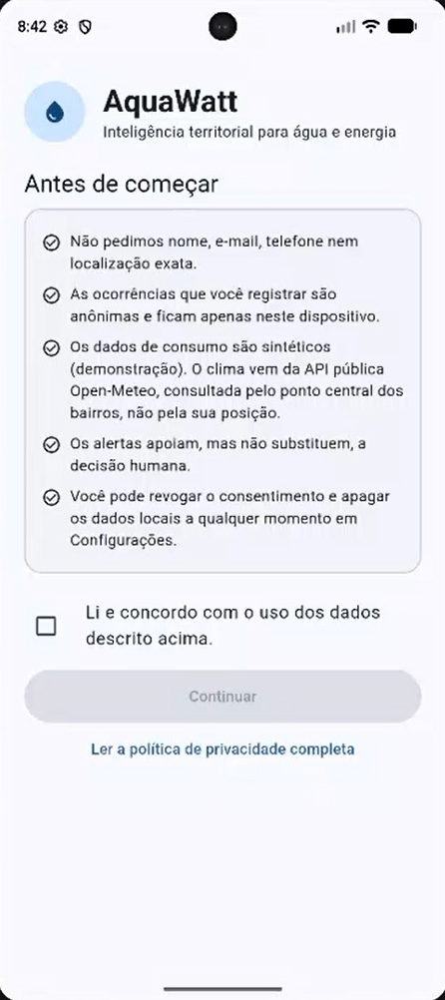<br>**Consentimento** explícito na primeira abertura | 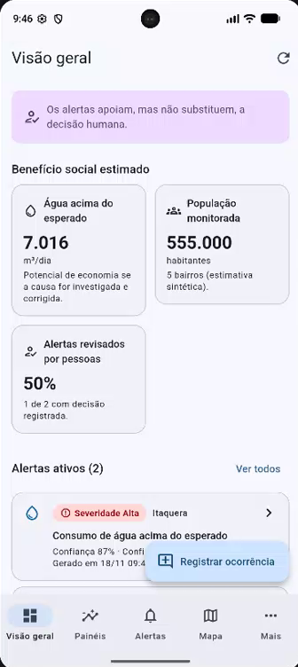<br>**Visão geral**: benefício social, alertas e bairros |
| 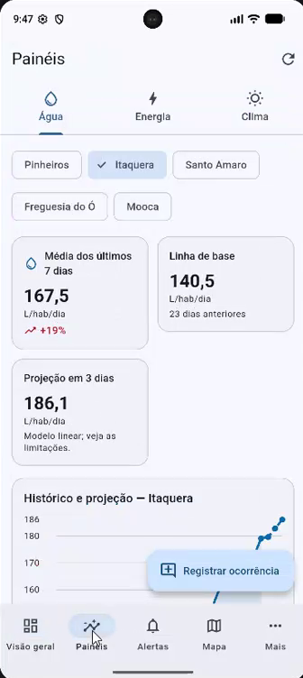<br>**Painel de Água**: KPIs, histórico, projeção e ranking | 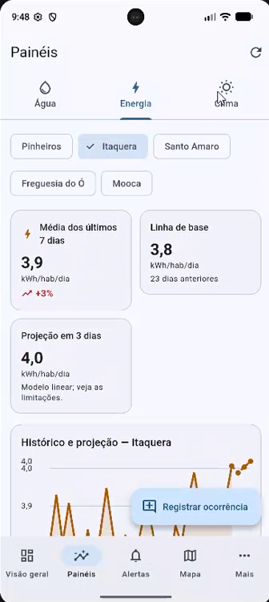<br>**Painel de Energia** com tendência e linha de base |
| 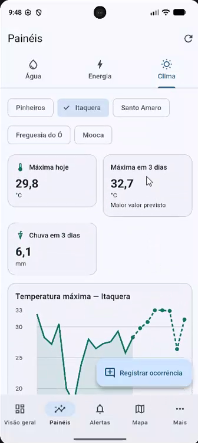<br>**Painel de Clima** (Open-Meteo): temperatura e chuva | 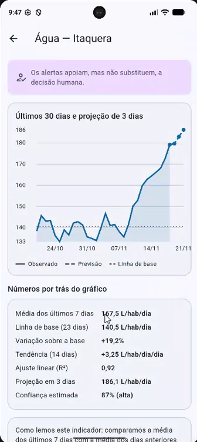<br>**Detalhe do indicador**: números por trás do gráfico |
| 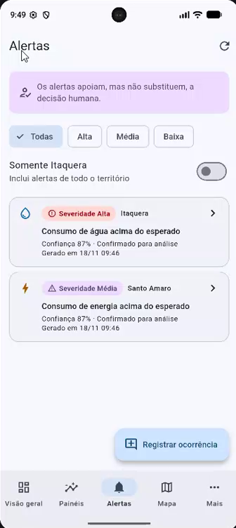<br>**Alertas** com filtros por severidade e bairro | 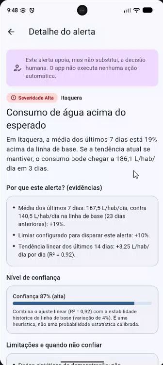<br>**Detalhe do alerta**: evidências, confiança, limitações e decisão humana |
| 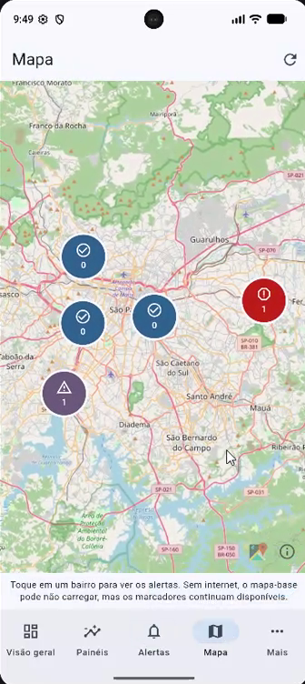<br>**Mapa** por bairro (cor, ícone e número de alertas) | 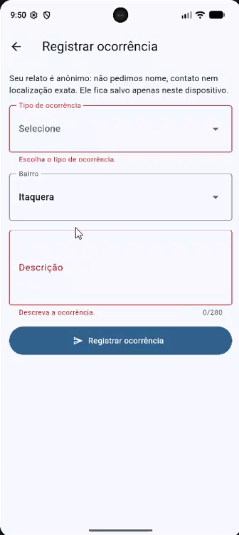<br>**Formulário** de ocorrência anônima, com validação |
| 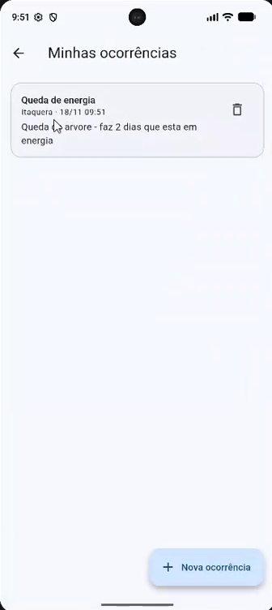<br>**Minhas ocorrências** (salvas offline) | 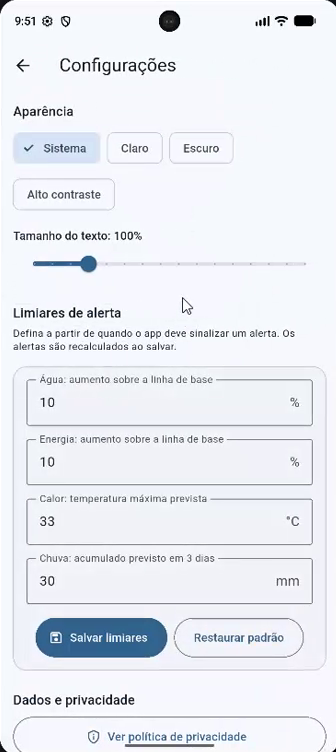<br>**Configurações**: tema, fonte e limiares de alerta |
| 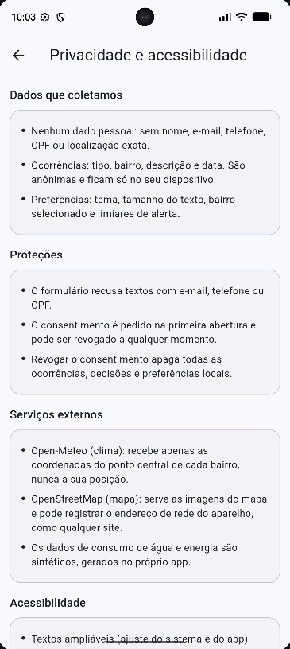<br>**Privacidade e acessibilidade** | 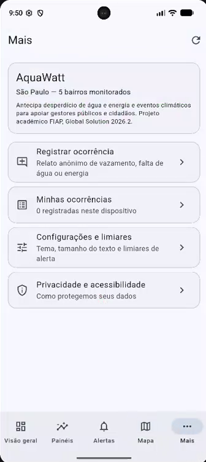<br>**Mais**: atalhos e sobre o app |

## 4. Funcionalidades

- [x] Navegação com rotas nomeadas e parâmetros (visão geral → detalhe do indicador → detalhe do alerta)
- [x] 3 dashboards distintos (Água, Energia, Clima) com KPIs, gráficos, histórico, projeção e tendência
- [x] Alertas gerados por regras e previsão linear, com justificativa, confiança, limitações e ação sugerida
- [x] Aviso visível de que os alertas apoiam, mas não substituem, a decisão humana
- [x] Registro da decisão humana (confirmar ou dispensar, com nota opcional)
- [x] Estado global (Provider) compartilhado entre várias telas, com carregamento, erro e lista vazia
- [x] Dados de serviço simulado (consumo) e de API pública real (clima, Open-Meteo)
- [x] Persistência local (preferências, limiares, ocorrências, decisões e cache do clima) e uso offline
- [x] Dois formulários com validação: ocorrência do cidadão e limiares de alerta
- [x] Mapa por bairro com severidade e contagem de alertas (diferencial)
- [x] Temas claro, escuro e alto contraste; fonte ajustável (diferencial)
- [x] Testes unitários da lógica de alertas e das validações (diferencial)
- [x] Consentimento explícito, anonimização e revogação com apagamento de dados
- [x] Indicadores de benefício social

## 5. Dados e alertas

### Fonte dos dados

| Dado | Origem | Observação |
|---|---|---|
| Consumo de água (L/hab/dia) e energia (kWh/hab/dia) | **Sintético**, gerado no app (`SyntheticDataService`) | Série determinística de 30 dias por bairro, com sazonalidade semanal, ruído e altas recentes em alguns bairros para demonstrar os alertas. Acessado de forma assíncrona com latência simulada, como seria uma API municipal. |
| Clima (temperatura máxima e chuva) | **Pública e real**: [Open-Meteo](https://open-meteo.com/) | Sem chave de API. 14 dias passados e 7 de previsão para o ponto central de cada bairro. |
| Populações | Estimativas aproximadas | Apenas para os indicadores de impacto. |
| Ocorrências e decisões | Geradas pelo usuário | Anônimas, salvas só no dispositivo. |

### Como os alertas são gerados

Toda a lógica está em `lib/domain/alert_engine.dart`, uma função pura e testada.

| Alerta | Regra | Severidade |
|---|---|---|
| Consumo de água/energia | Média dos últimos 7 dias ≥ linha de base (dias anteriores) + limiar (padrão 10%) | Média; **alta** se ≥ 1,5 × o limiar |
| Calor intenso | Máxima média prevista nos próximos 3 dias ≥ limiar (padrão 33 °C) | Média; alta se ≥ limiar + 3 °C |
| Chuva volumosa | Acumulado previsto em 3 dias ≥ limiar (padrão 30 mm) | Média; alta se ≥ 1,5 × o limiar |
| Relatos de vazamento | 2 ou mais relatos de vazamento no mesmo bairro em 7 dias | Baixa; média com 4 ou mais |

Os limiares são configuráveis no app e os alertas são recalculados ao salvar.

### Métricas e confiança

- **Desvio:** (média 7 dias − média da linha de base) ÷ média da linha de base.
- **Tendência e projeção:** regressão linear nos últimos 14 dias; projeção para 3 dias; **R²** como qualidade do ajuste.
- **Confiança (consumo):** `0,5 × R² + 0,5 × (1 − min(5 × CV, 1))`, limitada a 10%–95%, onde CV é o coeficiente de variação da linha de base.
- **Confiança (calor):** 85% para hoje, menos 8 pontos por dia de antecedência.
- **Confiança (chuva):** fixa em 55% (precipitação é menos previsível).
- **Confiança (vazamentos):** 20% + 10 pontos por relato, máximo de 60%.

> A confiança é uma **heurística transparente, não uma probabilidade estatística calibrada**. A tela do alerta explica como cada valor foi obtido.

### Limitações, vieses e quando as previsões não são confiáveis

- Os dados de consumo são **sintéticos**: demonstram o método, não medem a realidade de nenhum bairro.
- O modelo linear de 14 dias não captura sazonalidade, feriados, eventos nem mudanças bruscas.
- A linha de base cobre só ~23 dias e pode refletir um período atípico.
- **Não confie** na projeção quando o R² é baixo (< 0,30) ou quando a variação histórica é alta.
- Aumentos de consumo podem ter causas legítimas (mais moradores, obras, eventos); o alerta não identifica a causa.
- Previsão do tempo em grade de alguns quilômetros: microclimas podem diferir, e a confiança cai com a antecedência.
- A relação calor → demanda de energia é uma hipótese, não calibrada com dados reais.
- **Viés de cobertura:** bairros com menos acesso ao app geram menos relatos de vazamento.
- Sem conexão, o clima exibido é o último salvo; o app avisa e acrescenta essa limitação ao alerta.

### Decisão humana

O app **não toma nenhuma decisão automática**. Cada alerta mostra um aviso e uma *ação sugerida*; o gestor apenas registra seu parecer (confirmar para análise ou dispensar), que fica salvo no dispositivo.

## 6. Privacidade e inclusão

**Privacidade**
- Nenhum dado pessoal é coletado: sem nome, e-mail, telefone, CPF ou localização exata.
- Ocorrências são anônimas e ficam apenas no dispositivo; o formulário recusa textos com e-mail, telefone ou CPF.
- Tela de consentimento na primeira abertura; **revogar** em Configurações apaga ocorrências, decisões e preferências.
- A Open-Meteo recebe apenas as coordenadas dos bairros, nunca a posição do usuário.

**Acessibilidade**
- Textos ampliáveis (fonte do sistema e controle do app), com layouts que se adaptam.
- Temas claro, escuro e **alto contraste**; cores de indicadores escolhidas para bom contraste.
- Rótulos semânticos para leitores de tela em cartões, gráficos (resumo textual), botões e marcadores do mapa.
- Severidade sempre indicada por **ícone + texto**, nunca só por cor.
- Áreas de toque de pelo menos 48 px.

## 7. Tecnologias e decisões técnicas

| Escolha | Justificativa |
|---|---|
| **Flutter / Dart 3** | Um código para Android e iOS, exigido pela disciplina. |
| **provider** (`ChangeNotifier`) | Simples e suficiente para este escopo; separa estado global (`AppState`, `TerritoryController`, `OccurrencesController`) do estado local de cada tela (filtros, formulários, abas). |
| **shared_preferences** | Persistência leve de chave-valor (JSON) para preferências, limiares, ocorrências, decisões e cache do clima; leituras toleram dados corrompidos. |
| **http** + Open-Meteo | API pública, gratuita e sem chave: não há segredos no repositório. |
| **fl_chart** | Gráficos de linha com série tracejada (previsão) e linha de base. |
| **flutter_map** + **latlong2** | Mapa com tiles do OpenStreetMap, sem chave de API. |
| **flutter_localizations** | Textos nativos do Material em pt-BR. |
| Rotas nomeadas (`onGenerateRoute`) | Rotas centralizadas e argumentos tipados (`IndicatorArgs`, `AlertArgs`). |
| `flutter_test` | Testes unitários da lógica de alertas e das validações. |

**Arquitetura em camadas**

```
lib/
├── main.dart / app.dart        # inicialização, providers, tema, rotas
├── core/                       # rotas, tema, formatadores, validadores
├── domain/                     # modelos, estatística e motor de alertas (Dart puro)
├── data/                       # serviço simulado, cliente Open-Meteo, persistência
├── state/                      # controladores ChangeNotifier (estado global)
└── ui/
    ├── screens/                # telas
    └── widgets/                # componentes reutilizáveis (cartão, KPI, gráfico, estados)
test/                           # testes unitários
```

## 8. Como executar

Pré-requisito: [Flutter](https://docs.flutter.dev/get-started/install) estável (Dart ≥ 3.5) e um emulador ou aparelho.

```bash
# 1. Clonar
git clone <URL-DO-REPOSITORIO>
cd aquawatt

# 2. Gerar as pastas de plataforma (android/ e ios/), que não são versionadas aqui
flutter create . --org br.fiap --project-name aquawatt --platforms=android,ios

# 3. Instalar dependências
flutter pub get

# 4. Verificar e testar
flutter analyze
flutter test

# 5. Rodar
flutter run
```

Observações:
- **Variáveis de ambiente:** nenhuma. O app não usa chaves de API.
- Se o `flutter create` criar `test/widget_test.dart`, apague esse arquivo (ele referencia o app de exemplo). Confira com `git status` que `pubspec.yaml` e `lib/` não foram sobrescritos.
- Para **APK de release**, adicione a permissão de internet em `android/app/src/main/AndroidManifest.xml`, dentro de `<manifest>` e antes de `<application>`:
  `<uses-permission android:name="android.permission.INTERNET"/>`
  e depois rode `flutter build apk --release` (o APK fica em `build/app/outputs/flutter-apk/`).
- Sem internet o app continua útil: consumo, ocorrências e o último clima salvo seguem disponíveis (o mapa-base exige conexão).

## 9. Vídeo

[(Vído do projeto)](https://www.youtube.com/shorts/iIkcUxhrTe4?si=jBjk_-bW3aIRaDxR)

